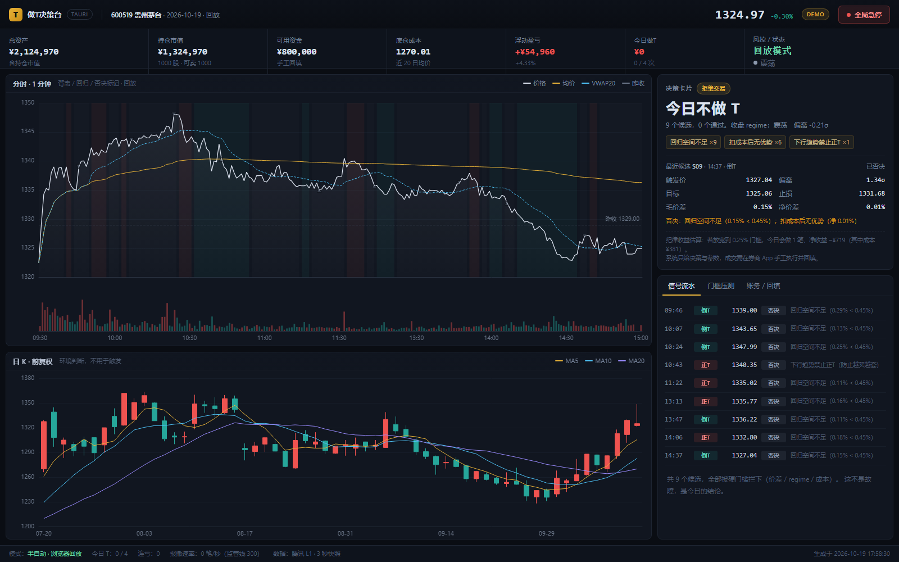
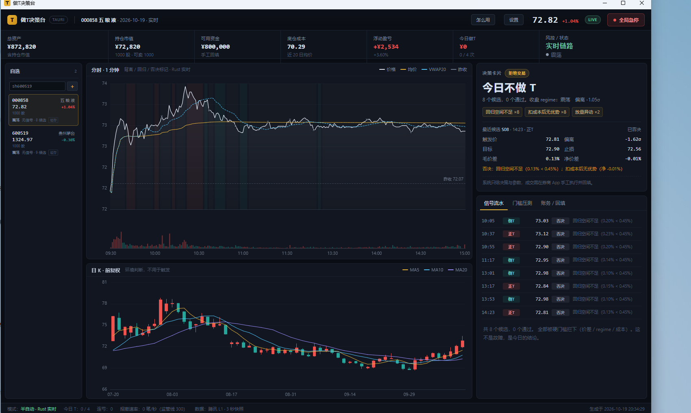
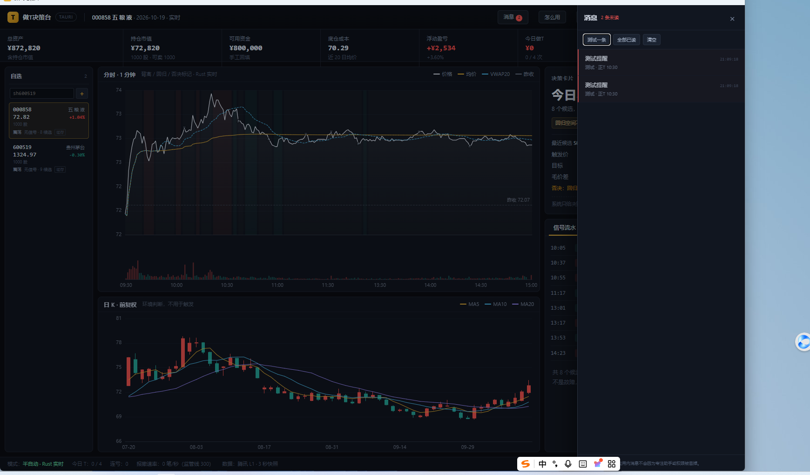
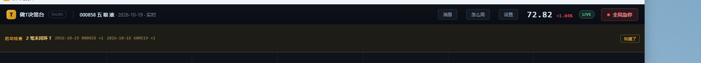

# 做T决策台 · Tauri 2 桌面端

Tauri 2（Rust）+ Vue 3 + TypeScript + Pinia + ECharts。
一套代码面向 Windows x64 与 macOS（Apple Silicon / Intel 通用二进制）。

> 当前是 **D1–D10 增量**：前端工作台完整可用；Rust 侧行情、SQLite 账本、分时缓存、regime、
> 信号引擎、T 对配对与冲正、交割单导入与对账、多票自选与批量扫描、托盘与消息中心、
> 盘中防休眠、单实例与启动完整性检查均已接入，并在 Windows MSVC 与 macOS arm64 双平台通过 `cargo test` / `cargo check`。
> 安装包已能在本机产出；签名与公证需要证书，尚未执行。



多票自选与按标的隔离的账务：



托盘常驻与应用内消息中心：



启动完整性检查（未闭环 T）：



## 快速开始

```bash
cd app
pnpm install

# 浏览器模式（用内置回放数据，不需要 Rust）
pnpm dev          # http://127.0.0.1:1425

# 构建前端（vue-tsc + vite）
pnpm build

# 桌面模式（需要 MSVC Build Tools）
# Windows 若提示找不到 link.exe，先在同一个终端执行：
#   call "C:\Program Files (x86)\Microsoft Visual Studio\2022\BuildTools\VC\Auxiliary\Build\vcvars64.bat"
pnpm tauri dev
```

> 端口用 **1425**，不是 Tauri 模板默认的 1420。
> 本机 1420 被另一个股票应用占用，`strictPort` 会直接报错。

## 状态（已验证 / 未验证）

| 项 | 状态 | 说明 |
|---|---|---|
| Vue 3 + TS 应用 | ✅ 已验证 | `vue-tsc --noEmit` + `vite build` 通过，产出 `dist/` |
| 工作台 UI | ✅ 已验证 | 分时 / 日K / 决策卡片 / 信号流水 / 门槛压测 / 账务回填，见 `shot.png`、`shot-test.png` |
| Pinia 数据层 | ✅ 已验证 | 浏览器用 `src/data/demo.json`；Tauri 模式走 IPC 注入 |
| IPC 桥 | ✅ 已验证（前端） | `src/lib/ipc.ts`，`__TAURI_INTERNALS__` 检测 + 事件订阅 |
| Tauri 运行 | ✅ 本机验证 | 2026-10-19 19:37 启动，LIVE 行情；`desk.db` 落盘 242 根分时 + 9 条信号 |
| Rust 行情骨架 | ✅ CI 通过 | Windows MSVC + macOS arm64 `cargo check` 通过 |
| SQLite 账本 | ✅ CI 通过 | 幂等/冲突/配对/部分成交/未闭环/冲正重放 |
| 回填幂等 | ✅ CI 通过 | `submit_fill` 双唯一键；前端回填表单已接通 |
| 分时链路 | ✅ CI 通过 | Rust 拉 242 点 → SQLite 缓存 → 特征/regime → `bootstrap` 直出图表 |
| 信号引擎 | ✅ CI 通过 | 4 个单测：回归通过 / 下行禁正T / 薄价差否决 / 冷却 |
| 信号落库 | ✅ CI 通过 | `signals` 表按 `(trade_day, id)` 去重，否决理由落库可复盘 |
| 跨语言一致性 | ✅ CI 通过 | 真实 242 点数据，Rust 与 Python 信号逐条对齐 |
| T 对配对 / 冲正 | ✅ CI 通过 | FIFO 配对、部分成交拆分、未闭环、void 重放 |
| 交割单导入 | ✅ CI 通过 | CSV/TXT、GB18030 回退、表头识别、自然键去重、手工单差异提示 |
| 配置与操作 | ✅ 本机验证 | 设置弹窗保存成功，配置落库并重载；操作指引可打开 |
| 多票自选 | ⚠️ 部分验证 | 列表渲染 + 每票配置存储/迁移单测通过；添加/切换需人工点一次 |
| 多票账务隔离 | ✅ CI 通过 | `fills` / `t_pairs` 新增 `symbol`，唯一键、配对重建、账本查询全部按标的隔离 |
| 多票批量扫描 | ✅ 本机验证 | 每票独立 regime / 候选 / 通过；缓存 + 4 路并发 + 失败退避，实测 8 / 9 候选且第二轮命中缓存 |
| 信号提醒 | ⚠️ 部分验证 | 系统通知 + 应用内横幅 + 提示音已接入；今日无通过信号未触发真实提醒，设置内提供“测试系统通知” |
| 托盘常驻 | ✅ 本机验证 | 关闭窗口只隐藏，进程存活；托盘图标存在，菜单含显示/退出 |
| 应用内消息中心 | ✅ 本机验证 | 测试提醒进入列表并出现未读角标；真实信号走同一事件 |
| 防休眠 | ⚠️ 部分验证 | 交易时段调用 `SetThreadExecutionState`；macOS 用 `caffeinate -i`；盘后释放。当前盘后无法实测 |
| 单实例 | ✅ 本机验证 | 启动第二个实例后立即退出，进程数保持 1 |
| 启动完整性检查 | ✅ 本机验证 | 未闭环 T 在顶栏横幅列出；测试数据已清理 |
| 多标的分时缓存 | ✅ 单测 + 真机 | `minute_raw` 主键含 `symbol`，旧库自动迁移；实测两只票各 242 根 |
| 回测引擎 v1 | ✅ 单测通过 | 单日/多日回测：限价撮合、费用、滑点、T+1 可卖额度、收盘触发；CSV 历史分钟导入 |
| Windows 安装包 | ✅ CI 构建 | NSIS 2.8MB + MSI 3.6MB，已从 CI 下载；本机 NSIS 解压被杀软拦截 |
| macOS universal dmg | ✅ CI 构建 | 6.8MB，覆盖 Apple Silicon + Intel；未真机安装 |
| 签名 / 公证 | ❌ 未执行 | 需要 Windows 证书与 Apple 开发者账号 |
| CI 编译门 | ✅ 全绿 | [run 39245093718](https://github.com/mhxy881126/autoT/actions/runs/39245093718)（17 单测） |
| 安装包 / macOS 产物 | ❌ 未产出 | 需 Windows MSVC 与 macOS + Xcode，见根目录技术方案 §7 |

**验证边界**：本机用 `vcvars64` 初始化 MSVC 后已实际启动窗口，看到 LIVE 行情与真实信号；
CI 负责 Windows/macOS 双平台编译与单测。安装包、签名与公证仍未做。

## 本机为什么编不了 Rust

```
error: error calling dlltool 'dlltool.exe': program not found
error: could not compile `parking_lot_core`
```

- `rustc` 1.96 存在，但 `link.exe` / `cl.exe` 不存在；
- GNU 工具链能链接 Hello World，但 `windows` crate 的导入库需要 `dlltool.exe`；
- crates.io 可访问，依赖能下载，卡在工具链而不是网络；
- macOS 通用二进制必须在 macOS 上构建，Windows 无法交叉编译。

在有 Visual Studio Build Tools（C++ 桌面开发）的机器上：

```bash
cd app/src-tauri
cargo check          # 先过类型检查
cd ..
pnpm tauri dev       # 再起窗口
```

## 目录

```
app/
├─ src/
│  ├─ App.vue                 # 布局：顶栏 / 账户条 / 图表 / 卡片 / 状态栏
│  ├─ components/
│  │  ├─ IntradayChart.vue    # 分时 + 成交量 + regime 背景 + 信号标记
│  │  ├─ KLineChart.vue       # 日K + MA5/10/20
│  │  ├─ DecisionCard.vue     # 通过 / 拒绝 / 等待信号 三态
│  │  └─ Panels.vue           # 信号流水 / 门槛压测 / 账务回填
│  ├─ stores/desk.ts          # Pinia：payload + live tick + 模式
│  ├─ lib/ipc.ts              # invoke / event / 浏览器降级
│  ├─ lib/types.ts            # 复用 ../../contracts/ipc.ts
│  └─ data/demo.json          # 2026-10-19 真实回放数据（68KB）
├─ src-tauri/
│  ├─ src/lib.rs              # Builder + 3 秒轮询 + market:tick
│  ├─ src/market.rs           # GB18030 解码 + 腾讯快照解析
│  ├─ src/session.rs          # 交易日 / 时段（Asia/Shanghai）
│  ├─ src/commands.rs         # app_info / fetch_quote / feed_status
│  └─ tauri.conf.json
├─ contracts/                 # 根目录：ipc.ts / schema.sql
└─ shot.png / shot-test.png
```

## 配置与操作

- 左侧 **自选**：输入 `sh600519` / `sz000858` 回车添加；点击切换标的；悬停点 × 移除。
  每只票独立保存一套参数（底仓、成本、z、目标、止损、次数、时段、暂停）。
- 左侧每票显示 **regime / 候选数 / 是否通过**，后台 60 秒批量扫描一次，不落库、不切换当前票。
- 扫描未命中时并发拉取分时；报价时间同一分钟内直接复用缓存，列表会标「缓存」。
- 并发上限 4 路；失败按 30s→60s→120s→240s→300s 退避，退避期有旧数据就标「重试中」。
- 通过数增加时发系统通知、页面顶部弹信号条、响一声提示音；设置里有「测试系统通知」。
- 顶栏 **消息**：未读角标 + 消息列表（标的、方向、时间、目标价），点一条直接切到该票；「测试一条」可验证。
- 关闭窗口只隐藏到托盘；托盘左键显示主窗口，右键菜单「显示主窗口 / 退出」。
- 右上角 **设置**：标的代码、底仓数量、底仓成本、可用资金、单次 T 仓上限、
  z 入场阈值、目标价差上下限、止损、每日次数、冷却、交易时段、暂停策略。
- 保存后写入 SQLite `symbol_configs`，并立即重载该标的的分时、日 K 与信号。
- 成交与配对表都带 `symbol`：不同股票的 T 对、持仓、未闭环互不串账。
- 右上角 **怎么用**：6 步操作说明（配置 → 看 regime → 读卡片 → 券商下单 → 回填/导入 → 复盘）。

## 打包

见 [RELEASE.md](./RELEASE.md)。

- Windows：`pnpm tauri build --bundles nsis,msi`
- macOS：`pnpm tauri build --target universal-apple-darwin --bundles dmg`
- CI：`.github/workflows/release.yml`，`workflow_dispatch` 或 `v*` tag 触发

## v0.2 回测基础

- `minute_raw` 主键改为 `(symbol, trade_day, t)`，旧库自动重建并迁移；多标的分时不再互相覆盖。
- 数据层：`store::save_minutes/load_minutes` 均按标的读写。
- 回测层：`backtest::run_day`，口径为
  - 信号分钟收盘生成，下一根分钟收盘做**限价撮合**：买单成交价不得高于信号价，卖单不得低于；不满足则跳过
  - 目标/止损用后续分钟收盘触发，按目标/止损价成交
  - 佣金（最低 5 元）、印花税、过户费、双边 2bp 滑点
  - T+1：每次 T 消耗底仓可卖额度，当天不回补
  - 同一时间只允许一笔 T，未平仓前跳过新信号
- 多日记分卡：`backtest::scorecard`，输出逐日净收益、胜率、盈亏比、最大回撤、no-trade 天数、与“不做”基线差。
- Tauri 命令：
  - `import_minutes_csv(symbol, csv)`：CSV 列 `day,time,price,cum_vol,cum_amt`，按天覆盖写入
  - `backtest_day(symbol, day, prevClose?)`
  - `backtest_range(symbol, days)`：按日期顺序跑多日，未缓存日期跳过
- 历史数据限制：目前只支持 CSV 导入；分钟点没有 OHLC，目标/止损按收盘价触发；没有 UI。

## D9 稳定性

- **防休眠**：交易时段在 Rust 里调用 Windows `SetThreadExecutionState(ES_CONTINUOUS | ES_SYSTEM_REQUIRED)`，
  只阻止系统睡眠、不强制亮屏；macOS 启 `caffeinate -i -w <pid>` 子进程。盘后自动释放。
  这些调用由一根专用 OS 线程串行执行，避免异步任务换线程导致释放落空。
- **单实例**：`tauri-plugin-single-instance`，第二个实例启动后立即退出并唤起已有窗口，避免双开重复轮询。
- **启动完整性检查**：启动时查询所有 `status <> 'CLOSED'` 的 T 对，按日 + 标的聚合，在顶栏横幅提示；
  不自动修改账本，必须人工处理或冲正。
- 导入本身在事务内，不存在“导入一半”的状态。

## 已实现的交互

- 浏览器模式：完整工作台，数据来自 `demo.json`（600519，2026-10-19）。
- Tauri 模式：`bootstrap` 拉真实分时 + 日K + 信号，图表与决策卡片都是当日数据；
  订阅 `market:tick` 与 `signals:update` 实时更新。
- 三张卡片状态：`通过` / `拒绝交易` / `等待信号`。没有信号时不猜方向。
- 门槛压测：严格 0.45% vs 放宽 0.25% 的对照，以及 0.20%–0.45% 敏感性柱状图。
- 账务页：回填成交、冲正、配对列表（正T/倒T）、已实现/未闭环汇总。无券商，回填是唯一成交来源。

## 下一步（对应技术方案 §8）

| 天 | 任务 | 状态 |
|---|---|---|
| D3 | SQLite 迁移 + `submit_fill` 幂等 + 账本 | ✅ CI 通过（5 单测） |
| D4 | 分时落盘 + `series` 命令 + 图表切实时 | ✅ CI 通过 |
| D5 | 特征 + regime + `market:tick` 全字段 | ✅ CI 通过 |
| D6 | 信号引擎 + 否决理由落库 | ✅ CI 通过 |
| D7 | T 对配对 + 未闭环识别 + 冲正 | ✅ CI 通过 |
| D8 | 交割单导入 + 对账 | ✅ CI 通过 |
| D9 | 防休眠 + 崩溃恢复 | 下一步 |
| D10 | Windows 安装包 + macOS universal dmg | 待做 |

## 已知问题

- **tick 的 regime 每 60 秒才刷新一次**：分时缓存按分钟重算，3 秒 tick 只更新价格与 z。
- **冲正后要换新 clientId 重新录入**；冲正保留原记录并标记 `voided`，配对按当日全量重放。
- **`position.available` 是近似值**：未闭环倒T时会偏保守；`unrealized` 暂为 0，接行情后补。
- **交割单仅支持 CSV/TXT**：Excel 需先另存为 CSV；表头靠关键词识别，券商自定义模板可能要在 `statement.rs` 里补映射。
- `src-tauri/icons/` 缺 `icon.icns`；macOS 打包前需在 macOS 上执行 `pnpm tauri icon icons/icon.png`。
- Tauri 模式没有单实例插件，先开两个窗口会重复轮询（P3 加 `tauri-plugin-single-instance`）。
- 前端包 1.29MB（ECharts 占大头）；桌面端可接受，若做 Web 分发需要按需引入。
